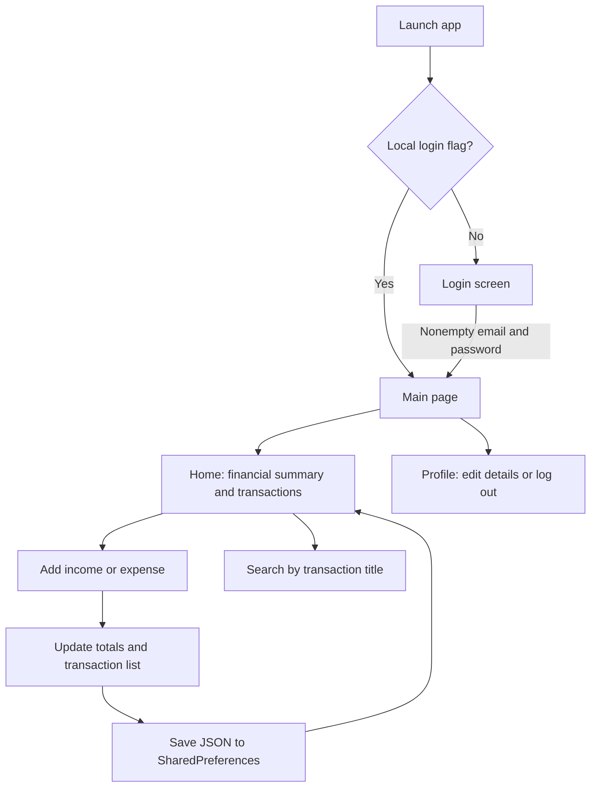
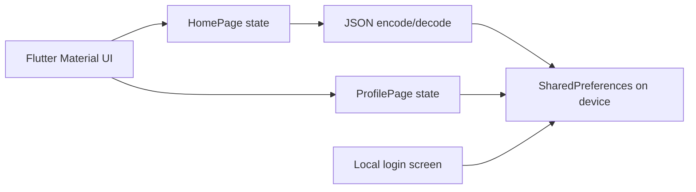

# Expense Tracker

**A lightweight, offline-first personal finance tracker built with Flutter and Dart.**

Expense Tracker is a mobile-oriented Flutter application for recording income and expenses, reviewing the current balance, and finding past transactions. It focuses on a simple workflow: **add a transaction, see its effect on your financial summary, and keep a local record on the device**.

The application stores transaction data using **SharedPreferences**. It does not require a backend, cloud database, or internet connection for the core transaction workflow.

> **Project status:** learning / portfolio prototype. Login is a local demo gate rather than a secure authentication system. The application has no cloud sync, account server, or payment integration. See [Limitations](#limitations-and-next-steps).

## Overview

Tracking daily spending can be cumbersome when income and expenses are scattered across notes or messaging apps. Expense Tracker brings basic personal cash-flow tracking into one interface.

### Features

| Feature | Implementation |
| --- | --- |
| Add transactions | Enter a title, amount, and transaction type (`Income` or `Expense`) |
| Financial summary | Automatically totals income, expenses, and the balance |
| Transaction history | Displays entries with their date, amount, and type; newest entries appear first |
| Search | Filters transactions by title, case-insensitively |
| Offline storage | Persists a JSON-encoded transaction list in SharedPreferences |
| Local sign-in state | Stores an `isLoggedIn` flag and an email value on the device |
| Profile | View or edit a locally stored name and email |
| Logout | Clears the local sign-in flag and returns to the login page |
| Navigation | Home and Profile tabs using a bottom navigation bar |

**Not implemented:** editing/deleting transactions, budgets, categories, recurring transactions, export/import, cross-device synchronization, or real server-side authentication.

## Screenshots

The screenshots below are included in this repository.

| Home and summary | Add transaction | Search transactions |
| :---: | :---: | :---: |
|  |  |  |

## How it works



### Adding a transaction

1. Open the **Home** tab and select the add button.
2. Enter a transaction title and numeric amount.
3. Select **Income** or **Expense**.
4. Submit the form.

The app automatically records the current date in `YYYY-MM-DD` format. The Home screen updates the displayed list and financial totals and saves transactions locally.

### Balance calculation

The dashboard derives the balance from all locally loaded transactions:

```text
Total income  = sum(amount) for transactions of type "Income"
Total expense = sum(amount) for transactions of type "Expense"

Balance = Total income - Total expense
```

Amounts are displayed using Indonesian currency formatting (`IDR`) through the `intl` package.

## Architecture and data

Expense Tracker is a **client-only Flutter application**, without a remote API.



### Transaction representation

The current implementation uses `Map<String, dynamic>` objects rather than a dedicated typed model. A stored entry resembles:

```json
{
  "title": "Groceries",
  "amount": 75000.0,
  "type": "Expense",
  "date": "2026-01-01"
}
```

Transactions are serialized as a JSON list under the SharedPreferences key `transactions`.

Other local keys include:

| Key | Purpose |
| --- | --- |
| `isLoggedIn` | Local sign-in flag |
| `email` | User email displayed in the profile |
| `name` | User's locally edited display name |
| `transactions` | JSON-encoded transaction history |

**Data storage is device-local.** It is not synchronized to another device and should not be treated as an encrypted, backed-up financial datastore.

## Tech stack

| Area | Technology |
| --- | --- |
| Framework | Flutter |
| Language | Dart |
| UI | Flutter Material widgets |
| Persistence | `shared_preferences` |
| Formatting | `intl` for currency and dates |
| Navigation | Flutter `Navigator` and `BottomNavigationBar` |
| Tests | `flutter_test` (widget test source included) |

The repository's `pubspec.yaml` specifies **Dart SDK `^3.6.1`**. For Android, the checked-in Gradle configuration sets `minSdk 21`, `compileSdk 34`, and `targetSdk 34`. Platform scaffold directories also exist for iOS, web, and desktop, but cross-platform operation has **not** been verified by this README update.

## Getting started

### Requirements

- Flutter SDK with a compatible Dart version (see `pubspec.yaml`).
- Android Studio or VS Code with Flutter tooling.
- An Android emulator or connected physical device. Other Flutter targets may require additional setup.

### Installation

```bash
git clone https://github.com/alfrzhb/expense_tracker.git
cd expense_tracker
flutter pub get
```

Check available devices and launch the application:

```bash
flutter devices
flutter run
```

No server, API key, or environment variable is required for local transaction tracking.

### Basic usage

The first screen asks for an email and password. **This is a demo-only form:** the code currently accepts any nonempty email and password, then stores a local flag. There is no account registration, password validation against a server, or secure session.

After opening the app:

1. Add sample income and expense transactions.
2. Observe the summary cards and updated balance.
3. Search for a transaction by its title.
4. Use the Profile tab to edit the locally stored name/email or log out.
5. Restart the application to check whether saved transactions load as expected.

### Build and test commands

```bash
flutter analyze
flutter test
flutter build apk
```

These are standard Flutter commands. **This README update did not execute them or verify test results.** The repository includes `test/widget_test.dart`, but its assumptions about the initial login state may require SharedPreferences mocking and test setup before all cases pass.

## Project structure

```text
expense_tracker/
├── lib/
│   ├── main.dart                   # App bootstrap and local login-status check
│   └── pages/
│       ├── splash_screen.dart      # Loading / login-status transition
│       ├── login_page.dart         # Local demo sign-in
│       ├── main_page.dart          # Home / Profile navigation
│       ├── home_page.dart          # Balances, search, transaction list and storage
│       ├── add_transaction_page.dart # New income/expense form
│       ├── profile_page.dart       # Profile display and logout
│       └── edit_profile_page.dart  # Local profile editing
├── assets/images/
│   ├── home.png                    # Screenshot: Home
│   ├── add_transaction.png         # Screenshot: Add transaction
│   └── search_transaction.png      # Screenshot: Search
├── test/
│   └── widget_test.dart            # Existing Flutter widget test source
├── android/                        # Android project configuration
├── ios/                            # iOS scaffold
├── web/                            # Web scaffold
├── linux/                          # Linux scaffold
├── macos/                          # macOS scaffold
├── windows/                        # Windows scaffold
└── pubspec.yaml                    # Dependencies and assets
```

## Limitations and next steps

This repository is an educational prototype with important scope boundaries.

- **No real authentication:** the login page accepts any nonempty credentials and only stores a boolean; it does not authenticate against a service. Do not use it to protect sensitive information.
- **SharedPreferences is basic storage:** transactions are stored as serialized JSON rather than in a transactional database. The data has no app-managed backup, encryption, or synchronization.
- **No transaction management beyond creation:** the UI does not support editing or deleting entries, or assigning categories.
- **Input validation is minimal:** an amount must parse as a number, but positive-only values and financial rounding are not enforced. A production finance app should use validated minor currency units or decimal-safe calculations.
- **Potential launch/navigation issue:** both `main.dart` and `splash_screen.dart` participate in login-state navigation; the splash implementation can navigate directly to `HomePage`, bypassing the normal bottom-navigation layout. This should be consolidated.
- **Widget tests are not verified:** the checked-in tests assume login conditions without demonstrating a controlled local-storage test fixture.
- **Release build is not production-signed:** the Android Gradle configuration currently uses a debug signing configuration for its release build.
- **License is unspecified:** the old README claimed MIT, but no root `LICENSE` file was found in the inspected repository tree. The license should be explicitly added before redistributing it under a named open-source license.

### Suggested improvements

1. Add transaction editing, deletion, validation, and a typed transaction model.
2. Replace JSON-in-preferences with a suitable local database when data volume and reliability requirements grow.
3. Consolidate splash/login/navigation logic and add reproducible widget tests.
4. Provide export/backup functionality and consider encrypted storage for sensitive data.
5. Add categories, monthly statistics, budgets, or charts only after the core data model and persistence are hardened.
6. Add an explicit license file and verify supported target platforms.

---

Maintained in [**alfrzhb/expense_tracker**](https://github.com/alfrzhb/expense_tracker). This README describes the current source implementation rather than claiming a released production finance application.
